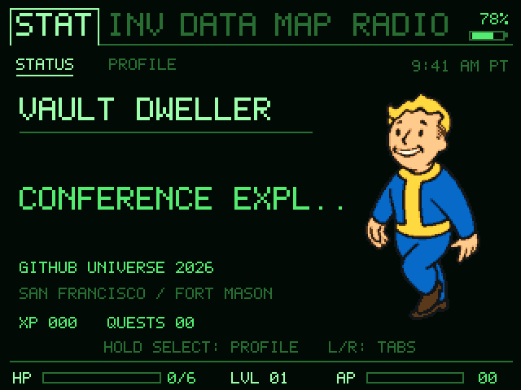
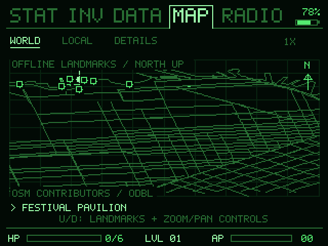
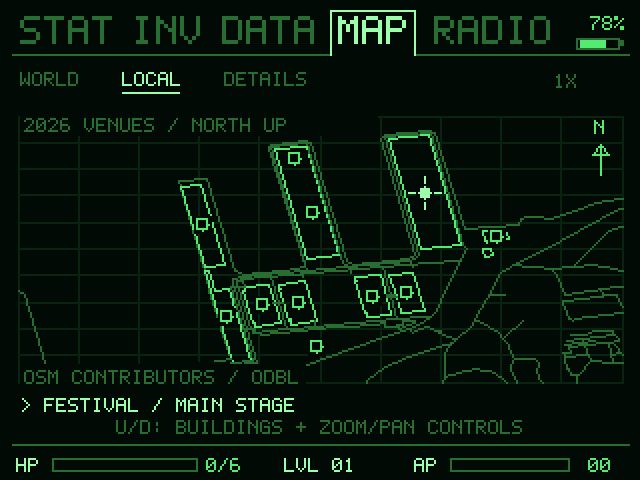
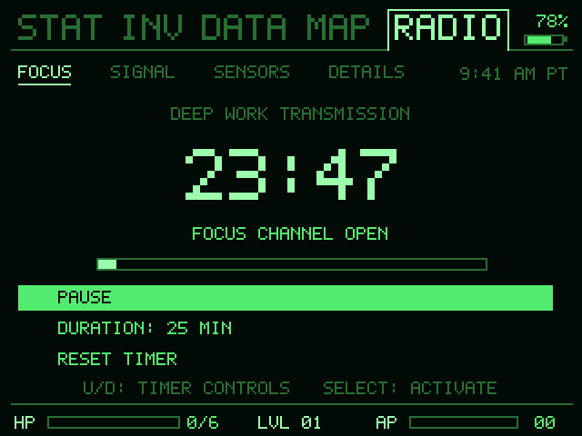

# Fallout for the GitHub Universe Badge

A pocket Pip-Boy for your conference day: animated Vault Boy, offline maps,
packing checklists, quests, focus timers, sensor readings and optional reminders.
Built for the Universe 2026 badge's 320 × 240 screen and physical buttons.
The app and browser preview are silent; notifications use the screen and case LEDs.

## On the screen

| Your Pip-Boy | Offline waterfront map |
| --- | --- |
|  |  |

| Fort Mason venue map | Focus timer |
| --- | --- |
|  |  |

Simulator screenshots rendered from the included app code at 2× its native
320 × 240 resolution. The profile and example telemetry are generic; displayed
battery values are sample inputs, not hardware measurements.

- **Make it yours:** Color or Shaded Vault Boy, green or gold themes, and Pixel or
  Vector text. A subtle CRT sweep passes over the entire screen.
- **Keep your day together:** packing lists, quests, optional agenda reminders,
  offline maps, focus timers and available badge sensors.
- **Save power automatically:** decorative lights start Off. Below 10% battery,
  ECO dims the screen, stops decorative animation and lights, and reduces polling.
  Buttons, timers and reminder cards remain usable; normal behavior returns at 12%.

The 12-row CRT sweep moves at 96 pixels/second, then pauses for a fresh random
20–45 seconds after each pass. ECO recovery also starts a full pause. See
[EFFECTS.md](EFFECTS.md) for details. These controls reduce activity; they are not
a promise of all-day battery runtime.

The download starts with a generic profile and an empty agenda. Public waterfront
and Fort Mason maps are included; personal hotel and social stops are excluded.
The LOCAL map includes published session venue and floor labels checked on
October 28, 2026. It retains campus building geometry; it does not reproduce the
GitHub Events mobile app's interior floorplan.

## Install in five steps

You need a **GitHub Universe 2026 Badger 2350 badge**, its supplied firmware and a
USB cable that carries data. No firmware flashing or Python installation is
needed for the direct-folder method.

1. Download this repository using **Code → Download ZIP**, then extract it.
2. Open the badge's supplied **USB Disk / Mass Storage** app and connect USB.
   A drive named **BADGER** should appear. Copy its current contents somewhere
   safe before making changes.
3. Open the extracted repository's `apps` folder. Copy only **`fallout`** into
   **`BADGER/apps/`**. Keep the whole folder, including `__init__.py`, modules,
   icon and assets. The final path must be:

   ```text
   BADGER/
   └── apps/
       └── fallout/
           ├── __init__.py
           ├── core.py
           └── ...all other supplied files
   ```

4. Wait for copying to finish, safely eject **BADGER**, then reset/restart the
   badge normally.
5. Open **Fallout** from the supplied launcher.

**Keep every existing stock app and file.** Do not replace `main.py`, format the
drive, flash a UF2, or touch `secrets.py`, Wi-Fi credentials or stock settings.
Do not copy this repository's README, tests or tools onto the badge. If your USB
volume has a different layout, stop and inspect its existing apps location rather
than creating a guessed second system tree.

### Updating, rolling back and removing

Before an update, copy any existing `apps/fallout/` folder off the badge, including
any local `config.json`. Replace only that custom app folder. Reapply your own
configuration separately; never overwrite it with someone else's profile.

To roll back, restore the previous custom app folder. To uninstall, remove only
`apps/fallout/`. Neither action requires changing the stock launcher or secrets.
Save data lives outside the app folder in `/state/` and may not be exposed on the
USB drive. Do not delete saves unless you intentionally want to reset progress.
Wait at least two seconds after changing settings, or use Home to save before
removing power. USB removal is safe after the host has finished copying/ejecting.

## Controls and everyday use

| Control | Action |
| --- | --- |
| Left / Right | Switch top-level tabs; move within directional editors |
| Up / Down | Select rows or scroll details |
| Select (tap) | Activate the selected item |
| Select (hold) | Change section; cancel a manual map-pin operation |
| Home | Save and return to the supplied launcher |

Start with **STAT → PROFILE → CONTROLS / HELP** for contextual controls.
Profile also contains Appearance, Font, Lights / Reminders and CRT Sweep.
Scroll to the last row for **Created with AI by DChevrier1**.

**Decorative lights Off** stops ambient waves; reminder flashes can still occur.
**Brightness Off** stops every case-light effect. ECO stops them all automatically.
The four case LEDs are **white**, not RGB. The separate red charging indicator is
controlled by the hardware/firmware and is not a Fallout effect.

Fallout does not connect to a GitHub account. To customize a fresh install, create
an optional `apps/fallout/config.json` locally; never commit personal versions:

```json
{
  "profile": {"name": "Your name", "handle": "your-handle", "organization": "", "role": "Attendee"},
  "schedule": []
}
```

Existing saved preferences may override initial configuration. Keep `config.json`
separate when updating. Schedule entries and reminder content are optional;
reminders require a correct badge clock and a running custom app. They cannot wake
a powered-off badge or appear over a stock app. See [EFFECTS.md](EFFECTS.md) for
power thresholds, intervals and lighting behavior.

## Offline maps and venue locations

**MAP → LOCAL** shows permanent Fort Mason buildings with the published event
locations below. Use Up/Down to browse buildings, then hold Select to open
**DETAILS** for the complete room labels and access notes.

| Published location | Campus marker |
| --- | --- |
| Main Stage, The Speakeasy, Silent Disco demos/breakouts | Festival Pavilion |
| Workshops, Level 1; Demos & Donuts, Level 2 | Gateway Pavilion |
| Cowell Theater | North end of Gateway Pavilion |
| BATS Theatre, Floor 3 | Building B |
| Sandbox / Founders Inc., Floor 3 | Building C |
| Ship & Tell | Firehouse |

Assignments come from the [official public session catalog](https://reg.githubuniverse.com/flow/github/universe26/attendee-portal/page/sessioncatalog),
checked October 28, 2026. Building geography follows OpenStreetMap and the
[Fort Mason campus reference](https://fortmason.org/wp-content/uploads/2025/11/Map.jpg).
The Outdoor Theater is in Gateway Plaza outside the pavilion; the Gateway marker
does not identify that stage's coordinates. Follow onsite signs for entrances,
floors and accessibility. These are building references, not verified interior
room, booth or stage positions, GPS locations, or calculated walking routes.

Maps work offline and retain their exported snapshot until the app is updated.
The generic repository still ships an empty agenda; these public venue labels
do not import anyone's bookings or personal calendar.

## Build and test from source

Python 3.9+ is needed only for local development and packaging. No external Python
dependencies are required:

```sh
python3 -m unittest discover -s tests -v
python3 build.py
```

The build creates `dist/fallout-badge.zip` with only the allowlisted app, install
instructions, screenshots and linked documentation. Extract it and copy
`apps/fallout` using the steps above. Personal configuration, credentials and
save files are excluded from the build allowlist.
Keep the documentation and screenshots with the download for reference. Copy
only the app folder to the badge.

Runtime code lives in `apps/fallout/`; portable logic is in `core.py`. The app is
self-contained and does not require any other custom app. Stock
firmware is a device prerequisite and is deliberately not redistributed here.

## Compatibility and troubleshooting

The runtime was exercised on the delivered Universe 2026 Badger 2350, with its
stock MonaOS 4.0 launcher and MicroPython 1.29.0-preview firmware build
`v1.14-6911.g2e1a6ab1ed.dirty`. The sanitized repository's defaults and build are
also tested locally. Older badges and other firmware versions are not verified.

- **No BADGER drive:** use a data-capable cable and open USB Disk / Mass Storage.
- **App missing:** check the exact folder path above; avoid double-nested folders.
- **Blank screen or import error:** verify every module and asset was copied,
  safely eject and restart. Keep the traceback if you need help diagnosing it.
- **Unexpected settings after an update:** saved preferences are intentionally
  preserved and may differ from fresh-install defaults.
- **No colored case lights:** the badge's case LEDs are white; screen colors are
  unrelated. Check the app's brightness/decorative-light settings.

The download contains this custom app, generic defaults, tests and documentation.
Stock firmware, personal agendas, credentials, device backups and browser sessions
are excluded.

## Credits and maintenance

**Created with AI by DChevrier1.** See [NOTICE.md](NOTICE.md) for artwork, map and
trademark provenance. This is an unofficial custom app, not an official firmware
release. Third-party artwork and marks retain their owners' rights.

For each change, update the README and in-app help, run the checks above, and
keep documentation screenshots aligned with the included app. Keep personal
configuration and save data outside version control.
